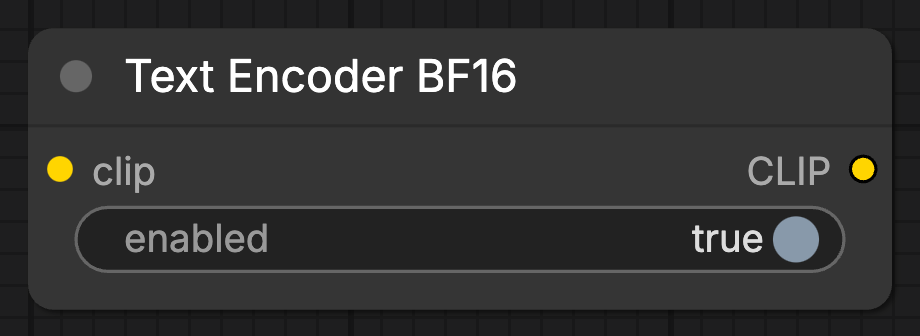
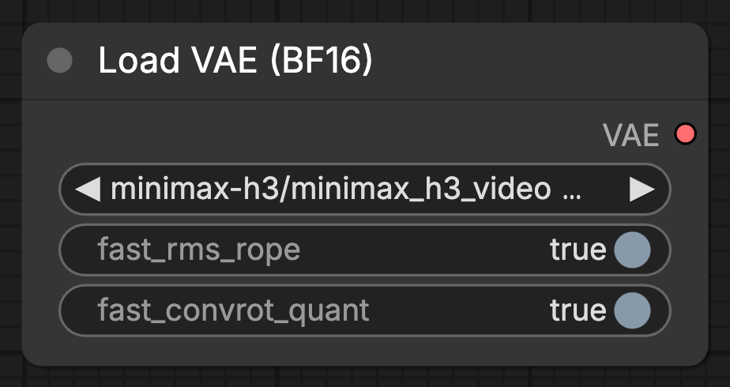
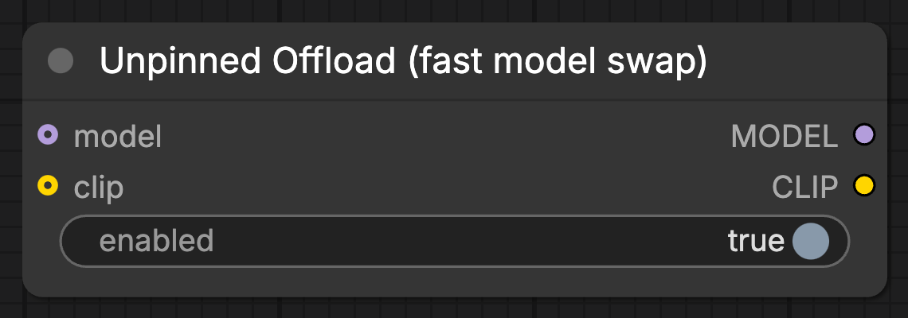
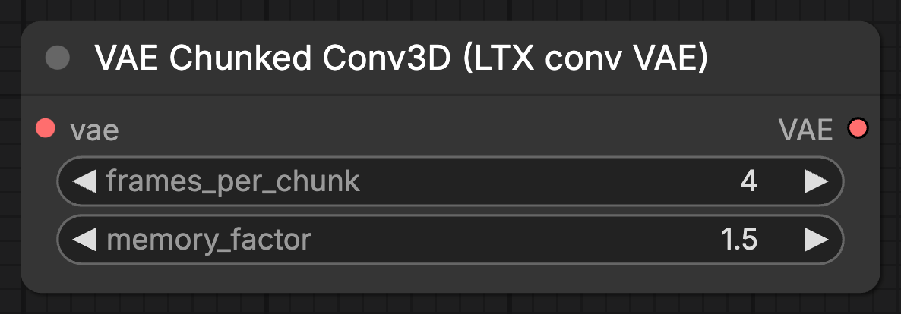

# ComfyUI-RDNA4-Accel

Speed-ups for ComfyUI on **AMD RDNA4** GPUs with ROCm, built and measured on the **Radeon AI PRO R9700** (gfx1201,
32 GB). Started with **MiniMax H3** (video and image); the nodes now also cover Qwen-Image 2.1, Krea 2, MOSS Image,
Z-Image and LTX-2.5. Each speed-up is a node you place in your workflow, so it affects only the models that pass
through it. ComfyUI's own files are not changed, and you keep using your existing checkpoints, LoRAs and text encoders.

Formerly *ComfyUI-H3-R9700-Accel*. Saved workflows keep working: the node IDs did not change.

| Node | Where it goes | What it does |
|---|---|---|
| [Text Encoder BF16](#text-encoder-bf16) | after **Load CLIP** | Runs Qwen3-VL / Qwen3.5 / Qwen3 4B / Gemma 4 text encoders (H3, Qwen-Image 2.1, Krea 2, MOSS Image, Z-Image, LTX-2.5) in bf16 instead of fp32 |
| [Load VAE (BF16)](#load-vae-bf16) | replaces **Load VAE** for the final video decode | bf16 VAE plus two Triton kernels |
| [Unpinned Offload (fast model swap)](#unpinned-offload-fast-model-swap) | on MODEL and CLIP (H3 Image, LTX-2.5) | Faster swaps between the text encoder and the image model |
| [VAE Chunked Conv3D (LTX conv VAE)](#vae-chunked-conv3d-ltx-conv-vae) | after **Load VAE** (LTX-2.5 conv video VAE) | Runs each 3D convolution a few frames at a time: a third of the VRAM, no driver hangs |

<p>




</p>

### Which node for which model

| Model | Text Encoder BF16 | Load VAE (BF16) | Unpinned Offload | VAE Chunked Conv3D |
|---|---|---|---|---|
| MiniMax H3 video (T2V / I2V / R2V) | ✓ | ✓ final decode only | ✗ (see its section) | – |
| MiniMax H3 Image (T2I / I2I) | ✓ | – | ✓ MODEL + CLIP | – |
| Qwen-Image 2.1 (T2I, edit, ControlNet, TextGenerate captioners) | ✓ | – | – | – |
| Krea 2 | ✓ | – | – | – |
| MOSS Image | ✓ | – | – | – |
| Z-Image (Lumina 2, e.g. REDZ) | ✓ | – | – | – |
| LTX-2.5 I2V | ✓ (Gemma 4) | – | ✓ MODEL + CLIP | ✓ with the conv video VAE |
| Wan 2.1 / SCAIL 2 | – (UMT5 is not covered) | – | – | – |

✓ tested and measured on the R9700 · – no effect or not tested (the node passes the model through unchanged) ·
✗ do not use.

## Results

Measured on one R9700 (power cap 220 W), ComfyUI with comfy-kitchen, MiniMax H3 int8 checkpoints:

| Job | Before | After |
|---|---|---|
| Video text encode (Qwen3-VL-32B nvfp4) | 42–48 s | 11–12 s |
| Video final decode, 10 s clip at 1376×768 | 43.4 s | 34.0 s |
| H3 Image T2I, prompt change (1088×1920, 8 steps) | 28.3 s | 16.1 s |
| H3 Image I2I, prompt change (one 2 MP reference, 8 steps) | 94 s | 38 s |
| LTX-2.5 I2V two-stage, 10 s clip at 1280×704, final decode | 51 s | 22 s |

The video decode figure is the same latent decoded both ways, timed with the order alternated.

## Install

**ComfyUI Manager:** *Install via Git URL* and paste
`https://github.com/penguinhelmet/ComfyUI-RDNA4-Accel`

**Manual:**

```sh
cd ComfyUI/custom_nodes
git clone https://github.com/penguinhelmet/ComfyUI-RDNA4-Accel
```

Restart ComfyUI. No extra Python packages are needed beyond what a ROCm ComfyUI already has (PyTorch with Triton,
comfy-kitchen).

### Requirements

- A ComfyUI version with MiniMax H3 support (video and image)
- PyTorch for ROCm with Triton
- comfy-kitchen with its HIP backend. The VAE kernels replace two of its calls.

Tested with ComfyUI 0.45, PyTorch 2.14.1+rocm7.2, Triton 3.8.0 and comfy-kitchen 0.2.41 on Ubuntu 24.04.

The kernels were tuned on gfx1201. On other RDNA4 cards (RX 9070 series), other AMD GPUs or NVIDIA they should still run, since they are plain Triton, but
the speed-up is not measured there.

---

## Text Encoder BF16


Put it between **Load CLIP** (the `qwen3vl_32b_minimax_h3` text encoder) and everything that uses the CLIP.

ComfyUI calls this text encoder with fp32 activations. Each nvfp4 layer is then dequantized to fp32 and runs as an
fp32 matrix multiply, which is slow on RDNA4. This node runs the language model in bf16 instead. The weights file,
the loader and the vision tower are unchanged. For H3 Image, the hidden states go back to fp32 before the model's fp32
text connector.

- Works for H3 video (T2V / I2V / R2V) and H3 Image (T2I / I2I). Other text encoders pass through unchanged.
- Also covers the other Qwen3-VL and Qwen3.5 encoders in ComfyUI, language model and vision tower:

  | Model | Encoder | Encode on a prompt change |
  |---|---|---|
  | Qwen-Image 2.1 Edit, one reference image | Qwen3-VL 8B | 42 s → 2.3 s |
  | MOSS Image | Qwen3.5 9B | 8.2 s → 0.7 s |
  | Krea 2 | Qwen3-VL 4B | 3.5 s → 0.2 s |
  | Z-Image / Lumina 2 (text only) | Qwen3 4B | 4.2 s → 0.7 s |
  | LTX-2.5 (text only, prompts padded to 1024 tokens) | Gemma 4 12B int8 | 37 s → 17 s |
- **TextGenerate** (image captioners, prompt enhancers) that runs through a CLIP from this node uses the bf16 path as
  well. Two Qwen3-VL captioners in a Qwen-Image ControlNet workflow: 35 s → 13 s.
- **Output:** the conditioning differs slightly from fp32. With the same seed you get a close variant: same
  composition and characters, with small changes in pose and detail. Set `enabled` to false to get the fp32 result.

## Load VAE (BF16)


A VAE loader for the **MiniMax H3 int8 video VAE** (`minimax_h3_video_vae_int8_convrot`). Wire it into the final
**VAE Decode** only.

Keep the normal **Load VAE** for anything that *encodes* (the reference image of Reference-to-Video). The encoded
latent conditions every sampling step, so even small changes there show up in the clip. The decode is the last step,
so changes there stay at the pixel level.

| Option | What it does |
|---|---|
| (always) | Runs the VAE with bf16 activations instead of fp16. comfy-kitchen then picks its faster tiled int8 GEMM for every layer (8–17 % per call). |
| `fast_rms_rope` | Triton RMSNorm + RoPE for the VAE's attention (head dim 64). About 9x faster per call than the generic kernel, and closer to an fp32 reference. |
| `fast_convrot_quant` | Triton ConvRot int8 quantizer (Hadamard-256 rotation + per-row int8) for the VAE's linear layers. About 3x faster per call. |

- The kernels are active only while this VAE decodes. Other models keep comfy-kitchen's kernels.
- Anything outside the shapes the kernels handle falls back to comfy-kitchen automatically.
- **Output:** 47 dB PSNR / SSIM 0.989 against the fp16 VAE, below what H.264 encoding changes.

## Unpinned Offload (fast model swap)


For **MiniMax H3 Image** and **LTX-2.5**. Put one node on the MODEL line (just before the guider / sampler) and the
CLIP line.

The text encoder (15 GB) and the H3 Image model (20 GB) do not fit in 32 GB together, so every prompt change moves
part of each between VRAM and RAM. By default ComfyUI page-locks (pins) the weights it moves to RAM. For a swap this
large, pinning costs more time than it saves. This node turns pinning off for the models passing through it.

- **Output:** pixel-identical images.
- LTX-2.5 (Gemma 4 12B text encoder 15 GB + 22B DiT 21.5 GB), 10 s clip, prompt change: 195 s → 175 s, with text
  encode 17 s → 6 s.
- Do **not** use it on the H3 *video* model. During stage-2 sampling that model is partly offloaded and streams its
  weights from pinned RAM.

## VAE Chunked Conv3D (LTX conv VAE)


For the **LTX-2.5 conv video VAE** (`ltx-2.5-video-vae-conv-bf16`). Put it between **Load VAE** and **VAE Decode**
(or **VAE Decode (Tiled)**).

With MIOpen off (ComfyUI's default on AMD), PyTorch runs each 3D convolution as vol2col + GEMM through a column
buffer of 4–5 GB. Buffers of different sizes pile up in PyTorch's cache: in one 10 s decode 8 GB was allocated but
30.6 GB reserved. At the card limit the amdgpu driver hung, and only a reboot cleared it. This node runs each 3×3×3
convolution on a few output frames at a time.

| Input | Default | What it does |
|---|---|---|
| `frames_per_chunk` | 4 | Output frames per convolution call. 0 turns chunking off. |
| `memory_factor` | 1.5 | Scales ComfyUI's estimate of the VRAM the decode needs, which decides how much of the diffusion model is moved out first. 2.5 for 10 s clips at 1280×704. |

- **Output:** same values (61 dB against the stock decode, which is rounding).
- An untiled 5 s decode took 7.8 s with 11.7 GB reserved.
- A tested setup for 10 s clips: Chunked Conv3D (4, 2.5) → **VAE Decode (Tiled)** with tile 1280, overlap 64,
  temporal 64, temporal overlap 16. Temporal tiles below 32/16 show visible changes at every block start.
- Only the conv VAE has these convolutions. The default LTX-2.5 video VAE (with attention) passes through unchanged.

---

## Example placement

**Video (two-stage latent upscale):**

```
Load CLIP ─► Text Encoder BF16 ─► (prompt / Reference to Video)
Load VAE ───────────────────────────────────► Reference to Video (encode)
Load VAE (BF16) ────────────────────────────► final VAE Decode
```

**Image (T2I / I2I):**

```
Load Diffusion Model ─► ... ─► Unpinned Offload ─(MODEL)─► guider / KSampler
Load CLIP ────────────────────► Unpinned Offload ─(CLIP)─► Text Encoder BF16 ─► MiniMax H3 Image Conditioning
```

## Example workflows

Six ready-made workflows are in [`example_workflows/`](example_workflows). After install they also appear in
ComfyUI under **Templates → ComfyUI-RDNA4-Accel**. Each has a note with its speed settings and measured times, and a
note with model links and folders.

| Workflow | What it is | Nodes from this repo |
|---|---|---|
| `MiniMax_H3_Video_Latent-Upscale_R2V.json` | H3 reference-to-video, two-stage latent upscale (10 + 2 steps) | Text Encoder BF16, Load VAE (BF16) |
| `MiniMax_H3_Image_T2I.json` | H3 Image text-to-image, 8 steps | Text Encoder BF16, Unpinned Offload |
| `MiniMax_H3_Image_I2I.json` | H3 Image edit with up to five reference pictures | Text Encoder BF16, Unpinned Offload |
| `Qwen_image_2_1_T2I.json` | Qwen-Image 2.1 turbo text-to-image, optional tiled Enhance Detail pass | Text Encoder BF16 |
| `Qwen_image_2_1_I2I.json` | Qwen-Image 2.1 edit (head / body swap with reference pictures), optional Enhance Detail | Text Encoder BF16 |
| `LTX-2.5_I2V.json` | LTX-2.5 image-to-video with audio, two stages (half size, x2 latent upscale, full size) | Text Encoder BF16, Unpinned Offload, VAE Chunked Conv3D |

They keep the model file names they were tested with (for example a fine-tuned H3 video checkpoint and LoRAs). Pick
your own files in the loader nodes.

The LTX-2.5 workflow loads the official distilled int8 model with int8 attention switched on. Make that file once
with the script in [`tools/`](tools):

```sh
python tools/add_int8_attention.py \
  ltx-2.5-22b-distilled-transformer-comfy-int8-convrot.safetensors \
  ltx-2.5-22b-distilled-transformer-comfy-int8-convrot-int8attn.safetensors \
  --attention 'transformer_blocks\.\d+\.attn1$'
```

Or pick the official file in **Load Diffusion Model**. It works, but stage 2 is slower.

The workflows also use other node packs:

| Pack | Used by |
|---|---|
| [ComfyUI-Pixaroma](https://github.com/pixaroma/ComfyUI-Pixaroma) | H3 (prompt, sizes, timer, save), Qwen (image loader, sizes) |
| [ComfyUI-KJNodes](https://github.com/kijai/ComfyUI-KJNodes) | H3 video, H3 I2I, Qwen I2I |
| [rgthree-comfy](https://github.com/rgthree/rgthree-comfy) | H3 video, H3 I2I, Qwen T2I, Qwen I2I |
| [ComfyUI-AusBoss](https://github.com/ausboss/ComfyUI-AusBoss) | Qwen T2I, Qwen I2I (tiled Enhance Detail) |
| [RES4LYF](https://github.com/ClownsharkBatwing/RES4LYF) | Qwen I2I |
| [ComfyUI-Easy-Use](https://github.com/yolain/ComfyUI-Easy-Use) | H3 video, Qwen T2I |
| [Comfyui_Minimax_h3_latent_Upscaler](https://github.com/LBH-123-AI/Comfyui_Minimax_h3_latent_Upscaler), [ComfyUI-VideoHelperSuite](https://github.com/Kosinkadink/ComfyUI-VideoHelperSuite), [ComfyUI_UniBlockSwap](https://github.com/smthemex/ComfyUI_UniBlockSwap) | H3 video |
| [H3-Video-LoRA-Loader-for-Image](https://github.com/DeepNeuralNerd/H3-Video-LoRA-Loader-for-Image) | H3 T2I |
| [ComfyUI-Penguinhelmet](https://github.com/penguinhelmet/ComfyUI-Penguinhelmet) | H3 I2I (image picker) |

The LTX-2.5 workflow uses only core nodes and this repo. ComfyUI Manager's *Install Missing Custom Nodes* finds most
of the others.

## If something breaks

Each node has a switch (`enabled`, `fast_rms_rope`, `fast_convrot_quant`). Switching it off returns that part to
stock ComfyUI behaviour without a restart. The nodes hook a few internal ComfyUI and comfy-kitchen functions, so an
update of either may need an update here. Please open an issue with your versions.

## About and license

- **Where it lives:** this GitHub repository. Bug reports and measurements on other setups are welcome in
  [Issues](https://github.com/penguinhelmet/ComfyUI-RDNA4-Accel/issues).
- **License:** [MIT](LICENSE).
- **No warranty:** the software comes as is. Keep a backup of workflows you care about.

ComfyUI-RDNA4-Accel is an independent, personal project. It is not affiliated with, endorsed by or sponsored by
Comfy Org, MiniMax or AMD. Product names and trademarks belong to their owners.
